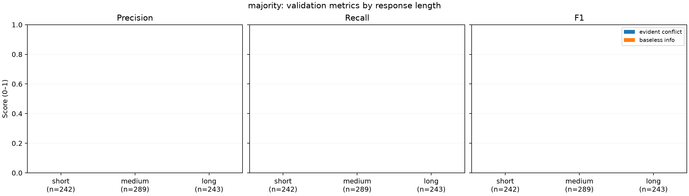
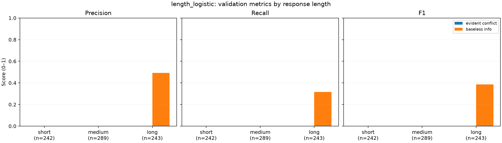
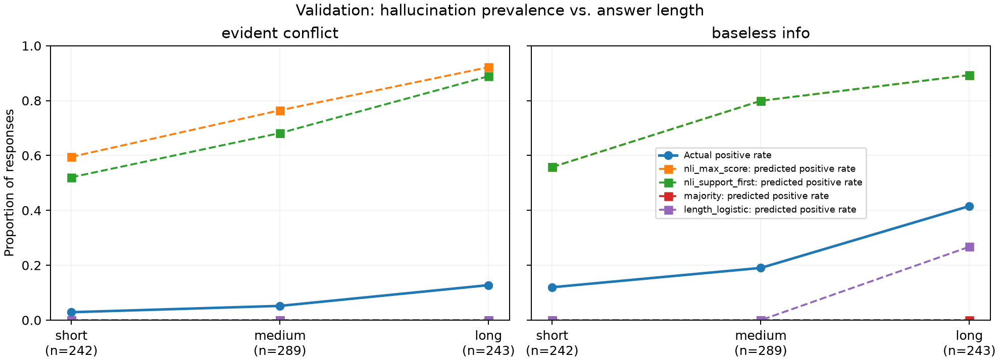
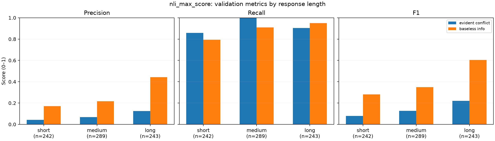
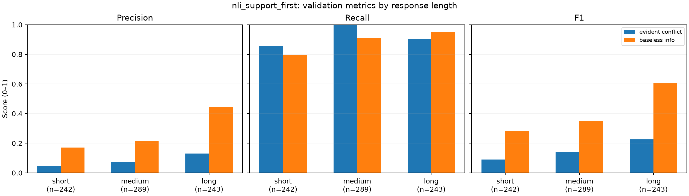

# RAGTruth QA Preprocessing

Reproducible data preprocessing for our COMS4705 NLP final project: **Hallucination Detection in Question Answering**.

We use [wandb/RAGTruth-processed](https://huggingface.co/datasets/wandb/RAGTruth-processed) to detect two types of hallucinations in AI-generated responses:

- **Evident conflict:** Information that contradicts the provided evidence.
- **Baseless information:** Information not supported by the provided evidence.

Our task is **multi-label binary classification**, with labels `[evident_conflict, baseless_info]`. Both labels may be positive for the same response.

## 1. Setup

Requires Python 3.11+.

```bash
git clone https://github.com/Qinyinnn/ragtruth-qa-preprocessing.git
cd ragtruth-qa-preprocessing

python3 -m venv .venv
source .venv/bin/activate
pip install -r requirements-lock.txt

# Generate full-context datasets
python scripts/preprocess.py

# Generate sentence-level datasets
python scripts/prepare_sentences.py

# Validate generated sentence-level data
python scripts/prepare_sentences.py --validate-only
```

The first run downloads the dataset and tokenizers from Hugging Face. No PyTorch installation is required for preprocessing.

**Note:** Generated JSONL datasets (~127 MB) are excluded from GitHub. Run the scripts above to reproduce them locally. Both audit reports are included in the repository.

### Run the response-level simple baselines

Once the QA files have been generated, run both simple baselines from the repository root:

```bash
python scripts/majority_baseline.py
python scripts/length_logistic_baseline.py
```

These scripts fit on `data/processed/qa_train.jsonl` **only** and export one prediction per response in the **774-example validation set**:

- `results/majority/val_predictions.jsonl`
- `results/length_logistic/val_predictions.jsonl`

Each JSONL line uses `{"response_id": "11868", "predicted_labels": [0, 0]}`. The label order is `[evident_conflict, baseless_info]`. The validation and test labels are never used to fit these baselines.

### Run the frozen NLI baseline

```bash
python scripts/evaluate_nli_baseline.py
python scripts/aggregate_nli_baseline.py
```

The NLI inference and aggregation scripts produce `results/nli_baseline/val_predictions.jsonl`. If a teammate has already run inference, the complete prediction file can instead be placed at that path locally. **Generated prediction JSONL files are not tracked in Git**; pulling the repository alone will not download them.

### Generate milestone metrics and figures

After the NLI validation predictions and both simple-baseline prediction files are available, run:

```bash
python scripts/metrics_report.py \
  --model majority=results/majority/val_predictions.jsonl \
  --model length_logistic=results/length_logistic/val_predictions.jsonl
```

The reporting script compares both simple baselines with the two frozen-NLI aggregation strategies. Outputs are saved in `results/milestone/`. If the reporting script raises `ModuleNotFoundError: No module named 'matplotlib'`, install the plotting dependency with `python -m pip install matplotlib` in the active environment.

Raw model predictions and generated datasets are excluded from Git. Final metrics and report figures may be committed.

## 2. Key Findings & Preprocessing Decisions

| Finding                                                   | Decision                                                                  |
| --------------------------------------------------------- | ------------------------------------------------------------------------- |
| ~30% of QA training examples exceed the 512-token budget  | Created sentence-level evidence–response pairs for zero-shot NLI          |
| Longer responses have higher hallucination-positive rates | Preserved response lengths for a length-only Logistic Regression baseline |
| Evident conflicts are rare (~7% of QA training examples)  | Preserved original label distributions for class-imbalance analysis       |
| Original annotations contain four hallucination types     | Retained the two processed binary labels and verified their mapping       |
| Some hallucination spans cross sentence boundaries        | Preserved original character offsets and recorded sentence overlaps       |
| Multiple responses share the same source                  | Used source-grouped validation splitting to reduce leakage                |
| Sentence-level labels can be derived from original hallucination spans | Used span overlaps to derive labels without modifying the original ground truth |
| Only 30 of 41,409 QA sentences (0.072%) contain both hallucination types | Retained multi-label ground truth; evaluated three-class NLI as an approximation |
| NLI inference requires combining predictions across evidence sentences | Compared max-score and support-first aggregation on validation data |

For detailed label definitions, aggregation methods, and evaluation
protocols, see [Evaluation Methodology](docs/evaluation_methodology.md).

### Dataset Splits

| Split      | QA examples |
| ---------- | ----------: |
| Train      |       4,260 |
| Validation |         774 |
| Test       |         900 |
| **Total**  |   **5,934** |

- Validation is created from the original training split using `GroupShuffleSplit(seed=42)`.
- The original Hugging Face test split is preserved unchanged.
- Related responses are grouped using a hash of `(task_type, query, context)` to prevent source overlap across splits.
- The processed dataset does not provide the original `source_id`, so near-duplicate sources may remain undetected. Original source IDs should be verified before final evaluation.

## 3. Which Files Should Teammates Use?

All generated files are located in `data/processed/`.

| Model / Experiment              | Files                                 |
| ------------------------------- | ------------------------------------- |
| Majority-class baseline         | `qa_{train,val,test}.jsonl`           |
| Length-only Logistic Regression | `qa_{train,val,test}.jsonl`           |
| Zero-shot NLI-DeBERTa           | `qa_{train,val,test}_sentences.jsonl` |
| QA-only DeBERTa fine-tuning     | `qa_{train,val,test}.jsonl`           |
| All-task fine-tuning            | `all_{train,val,test}.jsonl`          |

**Full-context files** contain original evidence, responses, binary labels, hallucination spans, token counts, and source-group identifiers.

**Sentence-level files** contain:

- `evidence_sentences[]`: sentences extracted from the source context.
- `response_sentences[]`: sentences extracted from the generated response.
- `span_overlaps[]`: original hallucination spans overlapping each response sentence.
- `original_spans`: unchanged hallucination annotations.
- `labels` / `response_labels`: original response-level binary labels.
- `pair_token_stats`: sentence-pair token-length statistics.

**Important:** Sentence-level files do not contain newly inferred sentence-level classification labels. Original response-level labels are preserved.

## 4. Sentence-Level Preprocessing

Implemented in `scripts/prepare_sentences.py` for the **zero-shot NLI-DeBERTa baseline**.

### Method

1. **Sentence segmentation:** Split `context` into evidence sentences and `output` into response sentences using newline boundaries and spaCy's rule-based sentencizer. Minor repairs handle list markers and incorrectly split code-like expressions.
2. **Span mapping:** Preserve original hallucination character offsets and record which response sentences overlap each span.
3. **Token-length analysis:** Measure evidence–response sentence pairs using the `MoritzLaurer/DeBERTa-v3-base-mnli-fever-anli` tokenizer, including special tokens.
4. **Validation:** Verify offsets, original text, labels, split membership, IDs, and token lengths. No original examples or annotations are modified.

### Verified Annotation Mapping

The original RAGTruth annotations contain four categories:

| Original annotation   | Processed binary label |
| --------------------- | ---------------------- |
| Evident Conflict      | `evident_conflict`     |
| Subtle Conflict       | `evident_conflict`     |
| Evident Baseless Info | `baseless_info`        |
| Subtle Baseless Info  | `baseless_info`        |

This mapping was verified across all QA examples.

**Important:** Despite its name, `evident_conflict` also includes _Subtle Conflict_ annotations.

Original hallucination spans use **0-based, end-exclusive character offsets** into the original `output`. All 2,927 QA spans were verified against their corresponding text.

### Sentence-Level Results

| Metric                     |   Train | Validation |   Test |
| -------------------------- | ------: | ---------: | -----: |
| Evidence–response pairs    | 466,813 |     78,125 | 83,236 |
| Maximum pair tokens        |     208 |        223 |    233 |
| Pairs exceeding 512 tokens |       0 |          0 |      0 |

Across all splits, **628,174 sentence pairs** were generated without exceeding the 512-token budget.

No text is truncated during preprocessing.

## 5. Important Limitations

These issues should be considered when implementing the models:

1. **Incomplete evidence:** Some claims require multiple evidence sentences. A single evidence–response pair may appear neutral even when the full context supports the claim. Consider multiple-sentence windows or evidence aggregation.

2. **Prediction aggregation:** The NLI model produces entailment, neutral, and contradiction scores for sentence pairs. `scripts/aggregate_nli_baseline.py` implements max-score and support-first strategies for converting these to response-level predictions, but this approximation can produce false positives and cannot fully represent all multi-label cases.

3. **Sentence-label ambiguity:** 519 hallucination spans cross sentence boundaries, and many cover only part of a sentence. Do not automatically assign the response's positive label to every sentence.

4. **Computational cost:** Comparing every evidence sentence with every response sentence produces ~628K pairs. Batched inference or evidence retrieval may be useful.

5. **Remaining truncation:** Sentence splitting resolves the length issue for individual sentence pairs, **not full-context fine-tuning**. Fine-tuning pipelines must separately handle long inputs without silently removing important evidence.

6. **Segmentation noise:** Rule-based sentence splitting may incorrectly segment code, tables, abbreviations, or unusual punctuation. Original text offsets remain preserved.

7. **Data quality:** Examples marked `truncated` or `incorrect_refusal` are retained. The team should agree on whether to include them during training and evaluation.

## 6. Reproducibility & Validation

- Dataset: `wandb/RAGTruth-processed`, pinned to revision `eb4f4b9d1b68eb7092d3e1a61c0cd82d9808737b`.
- Tokenizers: `microsoft/deberta-v3-base` and `MoritzLaurer/DeBERTa-v3-base-mnli-fever-anli`, with revisions pinned in the scripts.
- Random seed: `42`.
- Exact dependencies: `requirements-lock.txt`.
- Full-context outputs were reproduced byte-for-byte in an independent run. Sentence audit statistics also matched, apart from recorded file paths.

Run:

```bash
python scripts/prepare_sentences.py --validate-only
```

The validation checks include:

- Sentence offsets matching original text.
- No missing non-whitespace content.
- Unchanged labels, spans, and split assignments.
- No duplicated or cross-split IDs.
- Correct parent IDs and pair-token calculations.

The repository includes two reference reports:

| File                                 | Contents                                                                                       |
| ------------------------------------ | ---------------------------------------------------------------------------------------------- |
| `data/processed/audit_report.json`   | Dataset statistics, label distributions, response-length bias, token limits, and split checks  |
| `data/processed/sentence_audit.json` | Sentence counts, pair-token distributions, hallucination-span overlaps, and validation results |

Compare regenerated reports with these references to confirm reproducibility.


## 7. Evaluation Methodology, Baselines & Results

All models are evaluated using the **same original QA validation responses and response-level ground truth** with two binary targets: `[evident_conflict, baseless_info]`. Both can be positive for one response. The **test set remains held out**; all results below are preliminary **validation** results, not final test results. Note that the processed `evident_conflict` label includes both original *Evident Conflict* and *Subtle Conflict* annotations (see Section 4).

The main positive-class metrics are **precision, recall, and F1** for each hallucination label. We also report macro-F1 (the unweighted mean of the two per-label F1 scores), weighted-F1, micro-F1, and response-level exact-match accuracy. A prediction must match **both** labels to count toward exact-match accuracy. For details of NLI aggregation and evaluation, see [Evaluation Methodology](docs/evaluation_methodology.md).

### 7.1 Majority Class Baseline

**Implementation:** [`scripts/majority_baseline.py`](scripts/majority_baseline.py)

For each of the two labels, we count positive (`1`) and negative (`0`) examples in the **4,260-response QA training set** and choose the more frequent label. The baseline uses this pair of majority labels for **every** validation response. It does not read the answer text, evidence, question, or response length.

In our training set, the majority class is negative for both labels, so the baseline always predicts **`[0, 0]`**. We save all 774 predictions, keyed by `response_id`, to `results/majority/val_predictions.jsonl`.

**Validation results:**

| Metric | Evident conflict | Baseless information |
| --- | ---: | ---: |
| Precision | 0.0000 | 0.0000 |
| Recall | 0.0000 | 0.0000 |
| F1 | 0.0000 | 0.0000 |

- **Macro-F1:** 0.0000
- **Exact-match accuracy:** 0.7119

Although the baseline correctly predicts both labels for approximately 71.2% of validation responses, it never identifies a **positive hallucination case**. Thus, its positive-class precision, recall, and F1 are all zero. This demonstrates why accuracy alone is misleading when hallucination-positive labels are relatively rare.



**Figure interpretation:** For all three length groups, both labels have precision, recall, and F1 of zero. The flat result is expected because every prediction is `[0, 0]`, regardless of answer length.

### 7.2 Length-only Logistic Regression Baseline

**Implementation:** [`scripts/length_logistic_baseline.py`](scripts/length_logistic_baseline.py)

To measure whether answer length alone can predict hallucinations, we fit **two separate binary logistic regression models** using `sklearn.linear_model.LogisticRegression(max_iter=1000)`:

- **Predictor:** `response_tokens` — one numeric feature measuring the generated response length, computed during preprocessing using the standard DeBERTa-v3-base tokenizer.
- **Target 1:** `labels[0]`, the processed conflict label.
- **Target 2:** `labels[1]`, the baseless-information label.
- **Training:** Fit both models only on the 4,260 QA training responses.
- **Validation:** Predict labels for all 774 QA validation responses, using scikit-learn's default binary decision threshold of 0.5.

Each classifier learns its own coefficient and intercept to estimate the probability of a positive label from length alone:

`P(label = 1 | response_tokens = L) = sigmoid(a * L + b)`

No question, evidence, or response text is provided to these classifiers. The two predictions are combined into `[evident_conflict, baseless_info]` for each response and saved to `results/length_logistic/val_predictions.jsonl`.

**Validation results:**

| Metric | Evident conflict | Baseless information |
| --- | ---: | ---: |
| Precision | 0.0000 | 0.4923 |
| Recall | 0.0000 | 0.1730 |
| F1 | 0.0000 | 0.2560 |

- **Macro-F1:** 0.1280
- **Weighted-F1:** 0.1990
- **Exact-match accuracy:** 0.7132

The length-only model does not successfully detect any positive conflict cases. For baseless information, it reaches 0.4923 precision but only 0.1730 recall: **among responses it predicts as baseless, about 49% are actually positive, but it misses most true baseless cases**. Therefore, length provides a modest predictive signal, not a reliable content-grounded detector.



**Figure interpretation:** With the default 0.5 classification threshold, the length-only baseline has zero positive-class F1 in the short and medium bins. Its nonzero baseless-information precision, recall, and F1 are concentrated in the long bin. This is consistent with a decision rule driven by response length, rather than by evidence or factual content.

### 7.3 Overall Baseline Comparison

The table below was obtained from `results/milestone/metrics_summary.csv` using the same **774 QA validation responses** for every model. The frozen NLI baseline is evaluated using two sentence-pair aggregation methods: **max-score** and **support-first**.

| Model | Conflict F1 | Baseless F1 | Macro-F1 | Weighted-F1 | Exact-match accuracy |
| --- | ---: | ---: | ---: | ---: | ---: |
| Majority class | 0.0000 | 0.0000 | 0.0000 | 0.0000 | 0.7119 |
| Length-only logistic regression | 0.0000 | 0.2560 | 0.1280 | 0.1990 | 0.7132 |
| Frozen NLI — max-score | 0.1526 | 0.4401 | 0.2964 | 0.3761 | 0.1227 |
| Frozen NLI — support-first | 0.1655 | 0.4401 | **0.3028** | **0.3790** | 0.1499 |

**Interpretation:** Both frozen NLI aggregations achieve substantially higher positive-class F1 than the simple baselines, but they also produce many false positives. The support-first method improves conflict F1 slightly over max-score (0.1655 versus 0.1526), while baseless F1 is unchanged (0.4401). These results are *not* evidence that NLI fine-tuning improves performance: the NLI models reported here are **frozen**, and the separately fine-tuned models remain future experiments.

### 7.4 Response Length and Positive-label Rate

Responses are grouped using **training-derived** token-length cutoffs, rather than thresholds selected from validation outcomes:

| Group | Response length | Validation responses |
| --- | --- | ---: |
| Short | ≤108 tokens | 242 |
| Medium | 109–171 tokens | 289 |
| Long | >171 tokens | 243 |



**Figure interpretation:** The **actual** positive-label rate increases with response length for **both** hallucination categories. In the plotted validation data, baseless-information prevalence rises from roughly 12% in short answers to roughly 42% in long answers; the conflict rate also rises, but remains considerably lower. A longer response offers more opportunities for at least one hallucinated claim, which can lead to a positive **response-level** label.

The majority baseline predicts zero positives in every group. The length-only logistic regression predicts positive baseless-information labels primarily for long responses, yet underpredicts their actual prevalence. Conversely, the frozen NLI baseline predicts far more positives than the ground truth, especially in longer responses.

**Important distinction:** Increasing ground-truth positive-label rates with answer length establish a **length–label association in this dataset**. They do **not**, by themselves, prove that a particular model is unfairly biased by length. That question requires analyzing model predictions and errors conditional on length.

### 7.5 Frozen NLI Performance by Response Length



**Max-score aggregation:** Recall is high across short, medium, and long responses, but precision remains low, especially for conflict predictions. As response length increases, precision and F1 generally improve, yet the large false-positive burden limits overall reliability.



**Support-first aggregation:** The pattern is similar: high recall but low precision, with a small improvement over max-score for conflict F1. Both aggregations operate on sentence-pair NLI scores and must approximate two independent response-level hallucination labels. This mismatch is a limitation of the frozen baseline, not evidence of a failure in our response-level ground-truth annotations.

For context, the full-validation frozen NLI results include:

| Frozen NLI variant | Conflict precision | Conflict recall | Baseless precision | Baseless recall |
| --- | ---: | ---: | ---: | ---: |
| Max-score | 0.0832 | 0.9245 | 0.2899 | 0.9135 |
| Support-first | 0.0909 | 0.9245 | 0.2899 | 0.9135 |

The high recall (above 0.91 for both labels) paired with low precision indicates **substantial overprediction of hallucinations** and motivates subsequent task-specific fine-tuning and error analysis.

### 7.6 Key Takeaways and Next Experiments

1. **Class imbalance:** Always predicting `[0, 0]` achieves 71.2% exact-match accuracy but detects no positive hallucinations. Per-label positive-class F1 is essential.
2. **Answer length carries information:** The true positive rate rises with response length, and a length-only model obtains a baseless-information F1 of 0.2560. However, length by itself is insufficient for detecting individual hallucinations.
3. **Conflict detection remains difficult:** None of the simple baselines detects positive conflicts; frozen NLI detects many but with very low precision.
4. **Frozen NLI overpredicts positives:** Both sentence-level aggregation strategies show high recall but many false positives, motivating more appropriate response-level training.
5. **Planned fair comparison:** Fine-tune both an NLI-adapted DeBERTa-v3-base checkpoint and `microsoft/deberta-v3-base` using the **same QA training split, two-label classification head, and evaluation protocol** to isolate the contribution of prior NLI adaptation.
6. **Planned cross-task study:** Compare QA-only fine-tuning with training on QA, summarization, and data-to-text examples while evaluating on the same held-out QA data. Analyze token truncation for full-context training separately from the sentence-pair preprocessing described in Section 4.

### 7.7 Reproducibility and Output Files

Run the two simple baselines and shared report as described in [Section 1](#1-setup). The prediction files are **generated locally and ignored by Git**, so the reporting script also requires the frozen NLI predictions at `results/nli_baseline/val_predictions.jsonl` (generated by the NLI scripts or provided by a teammate).

The reporting script writes the following artifacts:

| Path | Description |
| --- | --- |
| `results/milestone/metrics_summary.csv` | Model-level precision, recall, F1, and other aggregate scores |
| `results/milestone/metrics.json` | Structured metrics for downstream analysis |
| `results/milestone/figures/majority_length_metrics.png` | Majority baseline performance by length |
| `results/milestone/figures/length_logistic_length_metrics.png` | Length-only logistic regression performance by length |
| `results/milestone/figures/length_bias.png` | Actual vs. predicted positive-label rates by length |
| `results/milestone/figures/nli_max_score_length_metrics.png` | Frozen NLI max-score performance by length |
| `results/milestone/figures/nli_support_first_length_metrics.png` | Frozen NLI support-first performance by length |

**Repository publishing note:** For GitHub to display the figures embedded above, the `.png` files must be committed alongside this README (subject to the repository's ignore rules). Generated datasets and individual response-level prediction JSONL files should remain untracked. These are preliminary **validation** results; do not describe them as final test results.

## 8. References

- [RAGTruth-processed Dataset](https://huggingface.co/datasets/wandb/RAGTruth-processed)
- [Original RAGTruth Dataset](https://github.com/ParticleMedia/RAGTruth)
- [Microsoft DeBERTa-v3-base](https://huggingface.co/microsoft/deberta-v3-base)
- [NLI-DeBERTa (MNLI/FEVER/ANLI)](https://huggingface.co/MoritzLaurer/DeBERTa-v3-base-mnli-fever-anli)

**Data usage:** Source code, documentation, audit statistics, and selected summary metrics/figures may be tracked in Git. Generated datasets and raw model prediction files remain excluded. Before redistributing generated datasets, check the applicable dataset licenses and terms.
